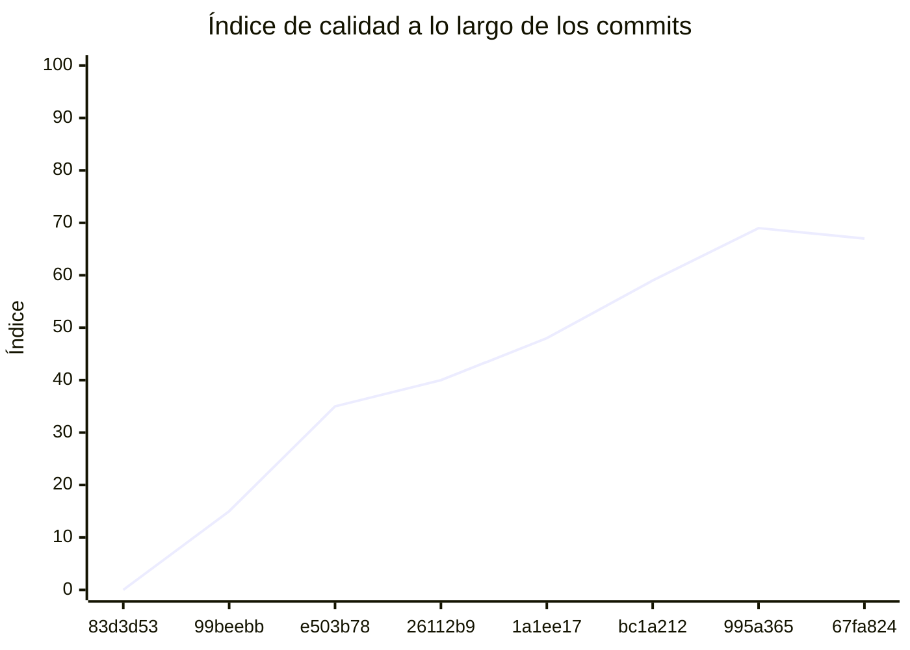

<!-- evaluacion:inicio -->
# Evaluación — prog2-yanez/servicio-catalogo

> Documento **generado automáticamente** por la cátedra de Programación II (UM): RepoSense + análisis de calidad de **7 dimensiones**. **No editar a mano**: se regenera en cada evaluación.
> Rama evaluada: `main`. Análisis **heurístico** (regex + métricas) + build: es una criba para orientar la revisión, **no una nota**. La **documentación** del repositorio no se evalúa.
> Generado: 2026-11-17.

## 1. Veredicto

| Aspecto | Resultado |
|---|---|
| Índice de calidad | **78/100** |
| Tipo de repositorio | `backend` |
| Build (`mvnw verify` / `gradlew check`) | OK |
| Código (LOC) | 4,813 |
| Archivos de código | 138 |
| Clases | 146 |
| Código dentro de clases (%POO) | 71% |
| Funciones fuera de clases | 0 |
| Duplicación (puerta) | 0.8% |
| Duplicación lógica | 0.9% |
| Duplicación de boilerplate | 10.4% |
| Cobertura | 99% |
| Tope duro aplicado a D1 | `POO_BAJO` → D1 ≤ 60 |

> Este informe **describe** lo que el análisis midió con los criterios ya establecidos de la materia. No es una nota.

## 2. Semáforo de aprobación

Criterios de la cátedra (`CRITERIOS-CALIDAD.md`): **Aprobar** se juega con el perfil `estandar`; **destacar**, con el `exigente` (meta de excelencia).

| Semáforo | Resultado |
|---|---|
| Aprobar (`estandar`) | **cumple** — 8/11 |
| Destacar (`exigente`) | **no cumple** — 6/11 |

**Para destacar, falta cumplir:** SOLID; POO

## 3. Autoría (RepoSense)

| Autor | Commits | Código (LOC) | Tests (LOC) | Docs (LOC) | Días activos | % del código |
|---|---:|---:|---:|---:|---:|---:|
| Guadalupe Yañez | 87 | 2,600 | 3,266 | 353 | 22 | 100% |

> _El LOC de autoría lo calcula RepoSense sobre el historial y puede diferir del LOC de código del análisis (que mira el estado de `main`)._

## 4. Dimensiones evaluadas

Cada dimensión indica **qué mide**, **por qué importa** y **tu resultado**. Cuando el puntaje queda por debajo de la referencia, se agregan preguntas para **investigar la causa** (no hay recetas).

| Dimensión | Peso | Puntaje |
|:--|--:|--:|
| **D1** Diseño OO, SOLID y patrones (20%) | 20% | 8 |
| **D2** Arquitectura hexagonal — backend (15%) | 15% | 100 |
| **D3** Frontend KMP: MVVM y buenas prácticas (10%) | 10% | N/A |
| **D4** Integración y contrato (10%) | 10% | 90 |
| **D5** Seguridad y robustez (10%) | 10% | 100 |
| **D6** Pruebas y cobertura (20%) | 20% | 100 |
| **D7** Proceso y entrega (15%) | 15% | 100 |

### D1. Diseño OO, SOLID y patrones (20%)

- **Qué mide:** Métricas orientadas a objetos (clases, métodos, campos, cohesión, acoplamiento, herencia) y proxies de SOLID, más patrones de diseño.
- **Por qué importa:** El eje de la materia es el buen uso de la POO y su arquitectura: un diseño con clases claras y poco acopladas es más fácil de entender, probar y cambiar.
- **Tu resultado:** **8/100**
- **Para investigar la causa:**
    - ¿Se pensó el modelo de clases antes de codificar o se agrupó después?
    - ¿Qué clases concentran muchas responsabilidades a la vez?
    - ¿Los colaboradores llegan como parámetros o se crean por dentro?

### D2. Arquitectura hexagonal — backend (15%)

- **Qué mide:** Separación en capas (dominio, puertos de entrada/salida, adaptadores) y dirección de las dependencias del backend.
- **Por qué importa:** Aislar el dominio de la infraestructura permite cambiar la base de datos, el framework o el transporte sin tocar las reglas de negocio.
- **Tu resultado:** **100/100**

### D4. Integración y contrato (10%)

- **Qué mide:** Cumplimiento del contrato de integración de la cátedra (formato de errores, paginación, autenticación, endpoints esperados).
- **Por qué importa:** Los servicios deben poder integrarse entre sí y con la app sin sorpresas; el contrato es lo que hacen cumplir las pruebas de integración.
- **Tu resultado:** **90/100**

### D5. Seguridad y robustez (10%)

- **Qué mide:** Credenciales embebidas, consultas SQL por concatenación, y presencia de config de entorno; aislamiento de secretos.
- **Por qué importa:** Un secreto en el repositorio o una consulta construida por concatenación son riesgos concretos, no hipotéticos.
- **Tu resultado:** **100/100**

### D6. Pruebas y cobertura (20%)

- **Qué mide:** Cantidad y resultado de pruebas y cobertura de línea (JaCoCo/Kover, Surefire/Failsafe) cuando hay build.
- **Por qué importa:** Las pruebas son la red de seguridad para refactorizar e integrar; la cobertura acota las zonas sin verificar.
- **Tu resultado:** **100/100**

### D7. Proceso y entrega (15%)

- **Qué mide:** Artefactos verificables de proceso/entrega: `compose`, `.env.example`, CI (`.github/workflows/`), `CODEOWNERS` y wrapper de build (`mvnw`/`gradlew`). **No** puntúa documentación.
- **Por qué importa:** Un proyecto que compila, se levanta y se valida solo es más fácil de revisar y de integrar en equipo.
- **Tu resultado:** **100/100**

## 5. Señales detectadas

El análisis encontró las siguientes señales (archivo, sin número de línea a propósito):

**DIP/concretos** (25)
- clase 'CorsConfig' muy acoplada (CBO=25) — `src/main/java/prog2/serviciocatalogo/config/CorsConfig.java`
- clase 'CorsConfig' instancia 4 concretos (CBO=25) — `src/main/java/prog2/serviciocatalogo/config/CorsConfig.java`
- clase 'RechazoComoProblema' muy acoplada (CBO=12) — `src/main/java/prog2/serviciocatalogo/config/CorsConfig.java`
- clase 'JwtConfig' muy acoplada (CBO=10) — `src/main/java/prog2/serviciocatalogo/config/JwtConfig.java`
- clase 'SecurityConfig' muy acoplada (CBO=20) — `src/main/java/prog2/serviciocatalogo/config/SecurityConfig.java`
- clase 'ManejadorErroresApi' muy acoplada (CBO=51) — `src/main/java/prog2/serviciocatalogo/shared/web/ManejadorErroresApi.java`
- clase 'CambiosCatalogoRedisAdapter' muy acoplada (CBO=20) — `src/main/java/prog2/serviciocatalogo/catalogo/infrastructure/catedra/CambiosCatalogoRedisAdapter.java`
- clase 'CambiosCatalogoRedisAdapter' instancia 3 concretos (CBO=20) — `src/main/java/prog2/serviciocatalogo/catalogo/infrastructure/catedra/CambiosCatalogoRedisAdapter.java`
- clase 'CatedraRestAdapter' muy acoplada (CBO=15) — `src/main/java/prog2/serviciocatalogo/catalogo/infrastructure/catedra/CatedraRestAdapter.java`
- clase 'CatedraRestAdapter' instancia 4 concretos (CBO=15) — `src/main/java/prog2/serviciocatalogo/catalogo/infrastructure/catedra/CatedraRestAdapter.java`
- clase 'ConsultaCategoriasPersistenceAdapter' muy acoplada (CBO=10) — `src/main/java/prog2/serviciocatalogo/catalogo/infrastructure/persistence/ConsultaCategoriasPersistenceAdapter.java`
- clase 'CatalogoPersistenceAdapter' muy acoplada (CBO=18) — `src/main/java/prog2/serviciocatalogo/catalogo/infrastructure/persistence/CatalogoPersistenceAdapter.java`
- clase 'ConsultaProfesionalesPersistenceAdapter' muy acoplada (CBO=15) — `src/main/java/prog2/serviciocatalogo/catalogo/infrastructure/persistence/ConsultaProfesionalesPersistenceAdapter.java`
- clase 'JpaEventoProcesadoRepository' muy acoplada (CBO=11) — `src/main/java/prog2/serviciocatalogo/catalogo/infrastructure/persistence/repository/JpaEventoProcesadoRepository.java`
- clase 'ProfesionalSpecifications' muy acoplada (CBO=8) — `src/main/java/prog2/serviciocatalogo/catalogo/infrastructure/persistence/specification/ProfesionalSpecifications.java`
- clase 'CatalogoActualizadoListener' muy acoplada (CBO=13) — `src/main/java/prog2/serviciocatalogo/catalogo/infrastructure/messaging/CatalogoActualizadoListener.java`
- clase 'KafkaConfig' muy acoplada (CBO=8) — `src/main/java/prog2/serviciocatalogo/catalogo/infrastructure/messaging/KafkaConfig.java`
- clase 'ProfesionalController' muy acoplada (CBO=10) — `src/main/java/prog2/serviciocatalogo/catalogo/infrastructure/web/ProfesionalController.java`
- clase 'InicializarCatalogoService' muy acoplada (CBO=9) — `src/main/java/prog2/serviciocatalogo/catalogo/application/usecases/InicializarCatalogoService.java`
- clase 'ActualizarCatalogoService' muy acoplada (CBO=21) — `src/main/java/prog2/serviciocatalogo/catalogo/application/usecases/ActualizarCatalogoService.java`
- clase 'SincronizarCatalogoService' muy acoplada (CBO=11) — `src/main/java/prog2/serviciocatalogo/catalogo/application/usecases/SincronizarCatalogoService.java`
- clase 'ConsultarProfesionalService' muy acoplada (CBO=13) — `src/main/java/prog2/serviciocatalogo/catalogo/application/usecases/ConsultarProfesionalService.java`
- clase 'ConsultarProfesionalService' instancia 4 concretos (CBO=13) — `src/main/java/prog2/serviciocatalogo/catalogo/application/usecases/ConsultarProfesionalService.java`
- clase 'ProcesarCatalogoActualizadoService' muy acoplada (CBO=13) — `src/main/java/prog2/serviciocatalogo/catalogo/application/usecases/ProcesarCatalogoActualizadoService.java`
- clase 'SituacionSincronizacion' muy acoplada (CBO=8) — `src/main/java/prog2/serviciocatalogo/catalogo/domain/model/SituacionSincronizacion.java`

**OCP/type-switch** (1)
- clase 'ManejadorErroresApi' con 3 type-checks — `src/main/java/prog2/serviciocatalogo/shared/web/ManejadorErroresApi.java`

**SRP/responsabilidad** (9)
- método 'ManejadorErroresApi.tituloSegunEstado' con complejidad 7 — `src/main/java/prog2/serviciocatalogo/shared/web/ManejadorErroresApi.java`
- clase 'CambiosCatalogoRedisAdapter' con baja cohesión (19%) — `src/main/java/prog2/serviciocatalogo/catalogo/infrastructure/catedra/CambiosCatalogoRedisAdapter.java`
- clase 'CatalogoPersistenceAdapter' grande (LOC=55, métodos=4, campos=8) — `src/main/java/prog2/serviciocatalogo/catalogo/infrastructure/persistence/CatalogoPersistenceAdapter.java`
- clase 'CatalogoPersistenceAdapter' con baja cohesión (33%) — `src/main/java/prog2/serviciocatalogo/catalogo/infrastructure/persistence/CatalogoPersistenceAdapter.java`
- método 'ProfesionalSpecifications.segun' con complejidad 7 — `src/main/java/prog2/serviciocatalogo/catalogo/infrastructure/persistence/specification/ProfesionalSpecifications.java`
- clase 'HorarioSemanalEntity' grande (LOC=21, métodos=0, campos=9) — `src/main/java/prog2/serviciocatalogo/catalogo/infrastructure/persistence/entity/HorarioSemanalEntity.java`
- método 'ProfesionalResumenResponse.ProfesionalResumenResponse' con 5 parámetros — `src/main/java/prog2/serviciocatalogo/catalogo/infrastructure/web/dto/ProfesionalResumenResponse.java`
- clase 'ActualizarCatalogoService' con baja cohesión (17%) — `src/main/java/prog2/serviciocatalogo/catalogo/application/usecases/ActualizarCatalogoService.java`
- método 'ActualizarCatalogoService.aplicarVersionesNuevas' con complejidad 6 — `src/main/java/prog2/serviciocatalogo/catalogo/application/usecases/ActualizarCatalogoService.java`

**?** (4)
- clase 'ProfesionalNoEncontradoException' con herencia profunda (DIT=2) — `src/main/java/prog2/serviciocatalogo/catalogo/domain/exception/ProfesionalNoEncontradoException.java`
- clase 'CatedraNoDisponibleException' con herencia profunda (DIT=2) — `src/main/java/prog2/serviciocatalogo/catalogo/domain/exception/CatedraNoDisponibleException.java`
- clase 'CatedraAccesoDenegadoException' con herencia profunda (DIT=2) — `src/main/java/prog2/serviciocatalogo/catalogo/domain/exception/CatedraAccesoDenegadoException.java`
- clase 'CategoriaNoEncontradaException' con herencia profunda (DIT=2) — `src/main/java/prog2/serviciocatalogo/catalogo/domain/exception/CategoriaNoEncontradaException.java`

## 6. Evolución por commit

Métricas calculadas sobre el estado de `main` en **cada commit** (8 commits con trabajo), del primero al último. La calidad usa el perfil `exigente`; el aporte de código lo mide RepoSense. El índice puede **bajar** al crecer el proyecto: se acumulan señales.

| # | Fecha | Commit | Autor | LOC | Índice | %POO | Duplic. | Sueltas |
|---|---|---|---|---:|---:|---:|---:|---:|
| 1 | 2026-09-10 | `83d3d53` | Ing. Daniel Quinteros | 0 | 0 | 0% | 0.0% | 0 |
| 2 | 2026-09-10 | `99beebb` | Ing. Daniel Quinteros | 0 | 15 | 0% | 0.0% | 0 |
| 3 | 2026-10-09 | `e503b78` | Guadalupe Yañez | 41 | 35 | 56% | 0.0% | 0 |
| 4 | 2026-10-12 | `26112b9` | Guadalupe Yañez | 41 | 40 | 56% | 0.0% | 0 |
| 5 | 2026-10-15 | `1a1ee17` | Guadalupe Yañez | 89 | 48 | 56% | 0.0% | 0 |
| 6 | 2026-10-19 | `bc1a212` | Guadalupe Yañez | 1,185 | 59 | 72% | 0.0% | 0 |
| 7 | 2026-10-27 | `995a365` | Guadalupe Yañez | 2,672 | 69 | 71% | 0.0% | 0 |
| 8 | 2026-11-07 | `67fa824` | Guadalupe Yañez | 4,813 | 67 | 71% | 0.8% | 0 |

---
_Informe generado por la cátedra. Las dimensiones y umbrales corresponden a `calidad.py` (perfil `exigente`); el semáforo, a `CRITERIOS-CALIDAD.md`. La documentación del repositorio no se evalúa. Ante dudas, revisá el archivo señalado._
<!-- evaluacion:fin -->
